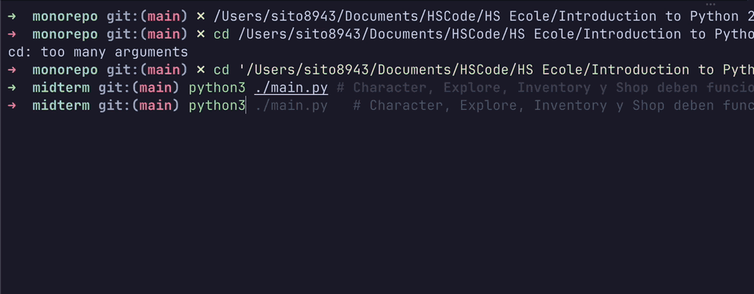
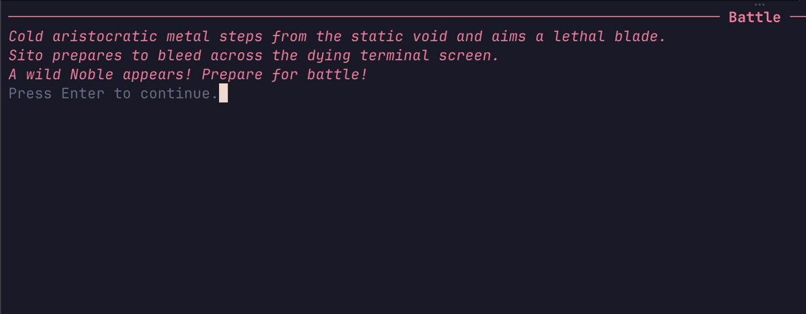
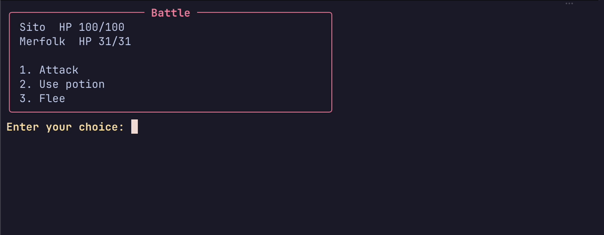
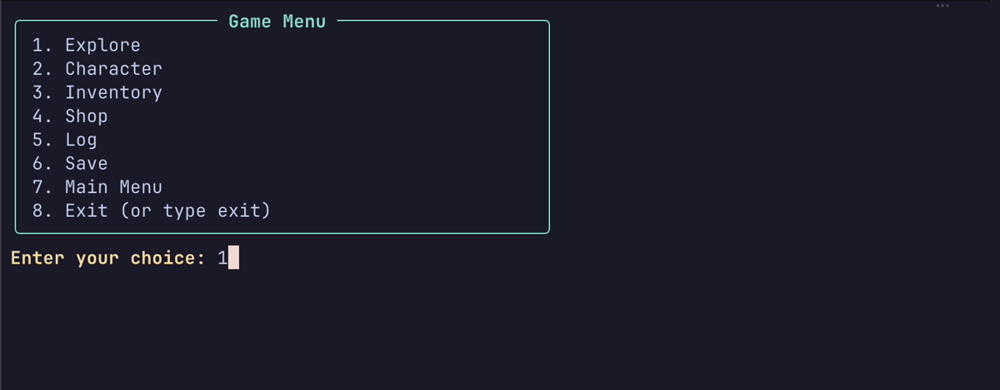

# THE TEXT-BASED RPG

> **Not Ogabek?** This README is the project report for grading. To install and play the game, read [HOW_TO.md](HOW_TO.md).



## Description
An event-driven, text-based role-playing game (RPG) that runs in the terminal. You create your character and venture into the "terminal void", an environment full of enemies, treasure and combat.

- **What problem it solves:** a small, replayable adventure that runs in any terminal, with no graphics engine. It is also a practice project for building a real Python program: split into modules, with a database, a log file, an external API, an AI, input validation and unit tests.
- **Main features:**
  - Create a character (name + Warrior, Hunter or Rogue class with its own starter weapon).
  - Explore: random battles, treasure or nothing, told by an **AI narrator** (Google Gemini).
  - Turn-based battles against real monsters from the **D&D 5e API**: attack, use a potion or flee.
  - XP, levels, gold, a shop with potions and better weapons, and an inventory.
  - Character sheet with **battles won**, a battle log, and save/load in a **SQLite** database.
  - Everything happens from an interactive menu; the game only closes with **Exit** or `exit`.
- **Who it's for:** people who like retro text games, and Python students who want to see a complete project.

## Screenshots

### AI narrator
 

### Battle


### Game menu


## Installation
```
pip3 install -r requirements.txt
cp .env.example .env   # optional: add your free Gemini key for the AI narrator
python3 ./main.py
```

Requirements, step-by-step setup, the `.env` values and how to play: see [HOW_TO.md](HOW_TO.md).

**Android:** the game also runs on Android phones: [m4-the-text-rpg-android](https://github.com/sito8943/m4-the-text-rpg-android).

### How to run tests
```
python3 -m unittest discover tests -v
```

*Note: Why unittest instead of pytest? Because it comes with python :)*


*Note: Why unit tests with classes? Because unittest force you to use classes :)*


*Note: Why @patch? Because is for mocking and preventing the real calling of methods which affect files or other external things :)*

## Usage


1. **Start Game / New Game** → type a name → choose a class.
2. **Explore** → the AI narrator tells what happens; in a battle choose **Attack**, **Use potion** or **Flee**.
3. **Character** shows your stats and battles won; **Log** shows the last battle lines.
4. **Save**, then type `exit`. Next time, **Continue Game** loads your character.

# Completed functionality and approximate grades
List of the points I accomplished and want to be graded for. Details and where to find each one are in the sections below.

| Criterion | Points |
|---|---|
| 🌶 Well-thought-out design (`rich` colours and panels, letter-by-letter text, delays) | 2 |
| 🫑 Returns to the menu after each action; exits only with `exit` | 1 |
| 🫑 All functions apart from `main` are in separate files | 1 |
| 🌶🌶 Accesible for people outside the course (public repo + Android app) | 4 |
| 🌶 Atomic commits spread over different days (7 days) | 2 |
| 🫑 Public on git: `requirements.txt`, `.gitignore`, `.env`, `README.md` (+0.5 each) | 1 + 2 |
| 🌶 GIF of the project | 2 |
| 🫑 Accepted pull requests (single-dev project) | 1 |
| 🫑 External file + 🌶 actual SQL database (SQLite) | 1 + 2 |
| 🫑 Unit tests (78 tests) | 1 |
| 🫑 External API (D&D 5e) + 🌶 connected AI (Gemini) | 1 + 2 |
| 🫑 Data structures: dict/list/set/tuple, generator, lambda, decorator (+0.5 each) | 1 + 2 |
| 🫑 Classes + 🌶 inheritance (`Enemy(Character)`) | 1 + 2 |
| 🫑 Error handling: `try/except` + regex validation (+0.5 each) | 1 + 1 |
| 🫑 Decomposition: no code outside functions, ≥10 functions, ≤300 lines/file, ≤80 lines/function, docstrings (+0.5 each) | 1 + 2 |
| 🫑 All interaction and restarting happen inside the app | 1 |
| 🫑 Logging (`logging` module) | 1 |
| 🌶 On-time submission | 2 |

**Approximate Total: 30/30 points** (about 38 before the 30-point cap)

### Menu
- **Interactive menu:** `GameManager._home_screen` and `GameManager._game_menu` (`managers/game_manager.py`) show the menus in a `while True` loop. After any action the program goes back to the menu.
- **Start over without restarting the app:** **Main Menu** (game menu) goes back to the home screen, and **New Game** (`GameManager._new_game`) asks for confirmation, empties the battle log (`LogManager.clear_log`) and replaces the current character with a new one.
- **One menu function:** home, game and battle menus are all drawn by `ScreenManager.print_menu`, so they look and behave the same.
- **Exit only with a specific command:** the program closes only when the player types `exit` (any case) or picks the **Exit** option in the home or game menu (`EXIT_COMMAND` and `GameManager._exit_game`).
- **Well-thought-out design:** `utils/console.py` uses `rich` for coloured panels and titles; `slow_print` writes story text letter by letter; `ScreenManager.message` can add delays (`wait`).

### Decomposition
- `main.py` only calls `config.setup()` and `GameManager().start_game()`.
- All other functions are in separate modules (`managers/`, `models/`, `prefabs/`, `utils/`).
- No code outside functions (only imports and constants at module level). 130 functions in total.
- No file has more than 300 lines (the biggest, `managers/game_manager.py`, has 161) and no function has more than 80 lines (the longest has 28).

### External files
- **SQL database:** the character is saved in a SQLite database, `game.db` (`sqlite3`, standard library).
  - `DatabaseManager` (`managers/database_manager.py`) creates the tables and runs the SQL: `CREATE TABLE IF NOT EXISTS`, `DELETE`, `INSERT` and `SELECT`.
  - 3 tables: `character` (one row: name, level, HP, XP, gold, class, weapon), `inventory` (one row per item) and `defeated_enemies` (one row per enemy; `PRIMARY KEY` keeps names unique, like the `set`).
  - Values are passed with `?` placeholders, never inside the SQL text, to prevent SQL injection.
  - `PlayerDataManager.save_data` / `load_data` (`managers/player_data_manager.py`) use it with `Character.to_dict` / `from_dict`.
- **Log file:** every battle turn is written to `battle_log.txt` instead of being kept only on screen.
  - Send new data to the file: `LogManager.write_log`.
  - Display the contents of the file: `LogManager.show_log` (menu option **5. Log**).
- **API cache:** monsters downloaded from the API are saved in `monsters_cache.json`, so they are not downloaded again and still work offline.
- **File access:** `FileManager` (`managers/file_manager.py`) reads, appends and writes files.

### API
- Enemies come from the [D&D 5e API](https://www.dnd5eapi.co) (334 monsters, free, no key).
- `ApiManager.fetch_monster` (`managers/api_manager.py`) picks a random monster whose challenge rating fits the character level (`challenge_ratings`).
- `create_api_enemy` (`prefabs/enemies.py`) converts the monster's HP, armor, attack and XP to this game's stats.
- Uses `urllib` from the standard library, so no extra package is needed.
- If there is no internet: a cached monster is used. If there is no cache either: an enemy from `prefabs/enemies.py` is used (`EventManager._spawn_enemy`).

### Config (.env)
- Settings live in a `.env` file, loaded with `python-dotenv` by `utils/config.py` (`setup`), which `main.py` calls first.
- `.env.example` is the template in the repo. `.env` is in `.gitignore`, so secrets are never committed.
- Values: `API_URL` and `API_TIMEOUT` (read in `ApiManager.__init__`), `LOG_LEVEL` (read in `config.setup`), `AI_API_KEY`, `AI_MODEL` and `AI_TIMEOUT` (read in `AiManager.__init__`).
- Every value has a default, so the game works without a `.env`.
- Validation: `API_TIMEOUT` or `AI_TIMEOUT` that is not a number (`ValueError`) and an unknown `LOG_LEVEL` use the default and write a warning to `game.log`.

### Logging
- The `logging` module writes a technical log to `game.log` (for the developer). It is separate from `battle_log.txt`, which is part of the game and is shown to the player.
- Set up once in `utils/config.py` (`setup`, called first in `main.py`) with `logging.basicConfig` (file, level `INFO`, format `date | level | message`).
- **info:** game started, game loaded, game saved, new game, game closed (`GameManager`, `PlayerDataManager`).
- **warning:** the API fails and the cache is used (`ApiManager.fetch_monster`), both fail and a prefab enemy is used (`EventManager._spawn_enemy`), or the AI fails and the default story is used (`AiManager.narrate`).
- **error:** broken or unwritable save database (`PlayerDataManager`) or broken monster cache (`ApiManager._load_cache`).

### AI
- **AI narrator:** `AiManager` (`managers/ai_manager.py`) asks Google Gemini (`gemini-flash-lite-latest`, free tier) to write a short story for each exploration event: battle, treasure and nothing (`EventManager`).
- Sends a POST request with `urllib` (JSON body, key in the `x-goog-api-key` header), so no extra package is needed.
- The game numbers (enemy name, gold found) stay as fixed lines, so the AI only writes the atmosphere.
- The key is a secret in `.env` (`AI_API_KEY`), never committed. `AI_MODEL` and `AI_TIMEOUT` are also in `.env`.
- **Fallback:** without a key, without internet, with a wrong key, too many requests (HTTP 429), a busy model (HTTP 503), a timeout or an unexpected answer, the default story from `prefabs/events.py` is used and a warning is written to `game.log`.

### Classes
- More than 2 classes: models (`Character`, `Enemy`, `CharacterClass`, `Weapon`, `Item`, `Inventory`, `Wallet`) and managers (`GameManager`, `BattleManager`, `AiManager`, `DatabaseManager`...).
- **Inheritance:** `Enemy(Character)` (`models/enemy.py`) reuses the character stats, attack and damage, and adds XP and gold rewards.

### Deploy
- Public GitHub repository: [sito8943/m4-the-text-rpg](https://github.com/sito8943/m4-the-text-rpg).
- Android app (the same Python game inside an APK, with a touch keyboard): [sito8943/m4-the-text-rpg-android](https://github.com/sito8943/m4-the-text-rpg-android).

### Data structures
- **dict:** menu options (`GameManager._game_menu`), battle actions (`BattleManager.start`), prefabs (`CLASSES`, `ENEMIES`, `ITEMS`, `WEAPONS`, `EVENTS`, `EVENT_CHANCES`, `SHOP_ITEMS`, `SHOP_WEAPONS`), save data (`to_dict` / `from_dict`).
- **list:** inventory items (`Inventory.items`, shown and used in `ActionManager._inventory`), battle turn text, log lines.
- **set:** enemies already defeated (`Character.defeated_enemies`), so each name is stored once.
- **generator:** `FileManager.read_lines` (`managers/file_manager.py`) yields the lines of a file one by one with `yield`, so the whole file is not loaded at once. `LogManager.show_log` uses it to show the battle log, and `LogManager.count_wins` loops over it (one line in memory at a time) to show **Battles won** in the character sheet.
- **decorator:** `requires_character` (`utils/decorators.py`) wraps the game menu actions (`_character`, `_explore`, `_inventory`, `_shop` in `ActionManager`). If there is no character it shows an error instead of running the action, so the check is written once.
- **tuple:** fixed data that never changes: `BATTLE_OPTIONS`, `GAME_OPTIONS`, `TREASURE_GOLD`, event stories, and each shop offer `(kind, key, price)` in `ActionManager._shop`.

### Exceptions
- `FileManager.read_file` handles `FileNotFoundError` (creates the file).
- `PlayerDataManager.load_data` and `save_data` handle `sqlite3.DatabaseError` (broken `game.db`).
- `ApiManager.fetch_monster` handles `URLError` (no internet), `TimeoutError` (slow API), `json.JSONDecodeError` (bad answer) and `KeyError` (missing fields), and falls back to the cache.
- `ApiManager._load_cache` handles `json.JSONDecodeError` (broken cache file).

### Data validation
- `ValidationManager.validate` (`managers/validation_manager.py`) checks a value against a rule set and returns the first error.
- Rules live in `prefabs/validations.py`: the name cannot be empty, needs at least 3 letters and can only contain letters and spaces.
- `GameManager._create_character` asks again until the name is valid.
- `GameManager._choose_class` asks again until the player picks one of the classes in `prefabs/classes.py`.
- Menus reject invalid choices and show an error.

### Functions documentation
- Every module, class and function has a docstring.

### Unit tests
- 78 tests in `tests/` for `Character`, `Wallet`, `ValidationManager`, `GameManager` (character creation, class choice, starter weapon, New Game, Main Menu, `exit` command), the inventory and the shop (`ActionManager`), event chances (`EventManager`), the `read_lines` generator (`FileManager`), battles won and clearing the log (`LogManager`), the `requires_character` decorator, `logging` messages (`assertLogs`), `.env` values (`patch.dict(os.environ)`), the SQLite save (`DatabaseManager`), the AI narrator and its fallback (`AiManager`) and the API (`ApiManager`, offline fallback, stat conversion). API tests use `@patch`, so they don't need internet.

### Git
- Atomic commits with a prefix (`add:`, `change:`, `fix:`, `feat:`), spread over 7 different days.
- `README.md`, `requirements.txt`, `.gitignore` and `.env.example` included (`.env` itself is ignored).
- **Pull requests:** each final feature was developed on its own branch and merged through a pull request: [#1](https://github.com/sito8943/m4-the-text-rpg/pull/1) generator, [#2](https://github.com/sito8943/m4-the-text-rpg/pull/2) decorator, [#3](https://github.com/sito8943/m4-the-text-rpg/pull/3) logging, [#4](https://github.com/sito8943/m4-the-text-rpg/pull/4) .env, [#5](https://github.com/sito8943/m4-the-text-rpg/pull/5) SQLite, [#6](https://github.com/sito8943/m4-the-text-rpg/pull/6) AI narrator.

## TODO

### Incomplete Planned Features
- [ ] Spells: MP is hidden for now; it will be used for spells.
- [ ] Defense: `defense_power` is shown in the character sheet but does not reduce damage yet.
- [ ] Download the Android APK from a GitHub Release.
- [ ] AI narrator for victory and defeat screens too.

## Project Structure
```
m4-the-text-rpg/
├── .gitignore           # Files to ignore in Git (saves, logs, cache, .env)
├── .env.example         # Template for the .env config (copy it to .env)
├── README.md            # Project report (this file)
├── HOW_TO.md            # How to install and play
├── requirements.txt     # Python dependencies (rich, python-dotenv)
├── main.py              # Entry point: config.setup() + GameManager().start_game()
├── managers/            # Game logic: menus, actions, events, battles, API, AI, database, log, screens, validation
├── models/              # Game objects: Character, Enemy, CharacterClass, Weapon, Item, Inventory, Wallet
├── prefabs/             # Game data: classes, enemies, weapons, items, shop, events, validation rules
├── utils/               # Helpers: config (.env + logging), console drawing, stat formulas, decorators
├── tests/               # Unit tests (unittest)
└── images/              # GIF and screenshots for this README
```
Created while playing (ignored by Git): `game.db` (save), `battle_log.txt` (battle log), `game.log` (technical log), `monsters_cache.json` (API cache).

## Acknowledgments
- 👾 [D&D 5e API](https://www.dnd5eapi.co) for the monsters.
- 🤖 [Google Gemini](https://ai.google.dev) for the AI narrator.
- ✨ [rich](https://github.com/Textualize/rich) for the colours and panels, and [python-dotenv](https://github.com/theskumar/python-dotenv) for the `.env` file. 
- 😏 Ogabek and the Python II course at Harbour.Space.
- 🧡 [Claude Code](https://claude.com/claude-code) as a coding assistant for explanations, code reviews and tests. 

## Team Members
- Carlos Andrés Mora González, GitHub: [@sito8943](https://github.com/sito8943)

## Support
Found a bug or have an idea? Open an issue: [github.com/sito8943/m4-the-text-rpg/issues](https://github.com/sito8943/m4-the-text-rpg/issues).
